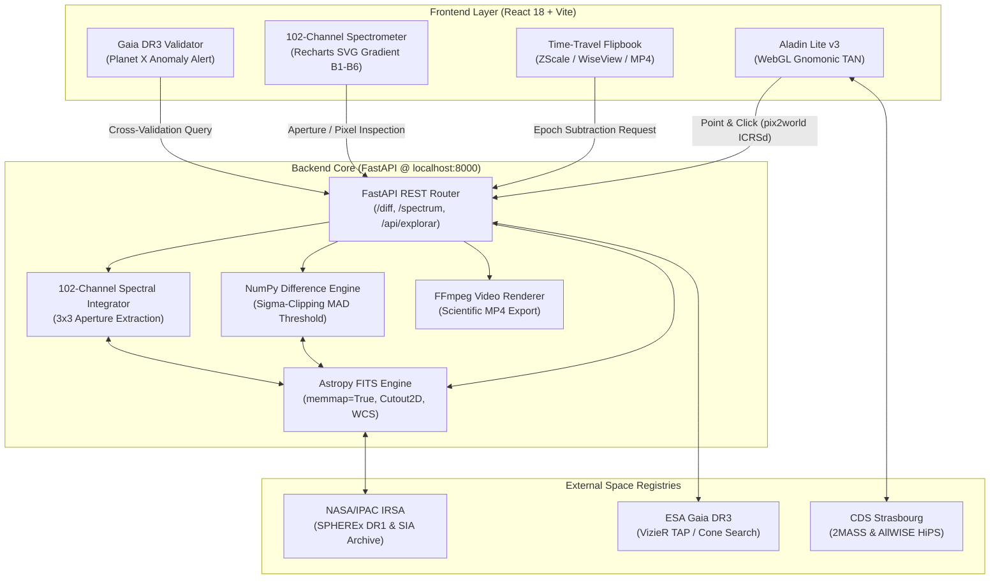

<div align="center">

# 🌌 LOOKING FOR STAR (LFS)
### SPHEREx Time-Domain & 102-Channel Infrared Spectral Explorer

> *"Every star has a story. Discover it."*

An open-science astrophysics exploration and time-domain analysis platform engineered for the **NASA International Space Apps Challenge** (*Track: Planet X and SPHEREx*). Designed for the automated identification, time-series subtraction, and astrometric validation of transient phenomena, Planet X candidates, ultra-cool sub-stellar brown dwarfs, and extreme high proper motion stars using live scientific telemetry from the **NASA SPHEREx Space Mission**, **NASA/IPAC IRSA**, and the **ESA Gaia DR3** catalog.

---

[](https://fastapi.tiangolo.com/)
[](https://www.python.org/)
[](https://www.astropy.org/)
[](https://numpy.org/)
[](https://react.dev/)
[](https://vitejs.dev/)
[](https://tailwindcss.com/)
[](https://aladin.cds.unistra.fr/AladinLite/)
[](https://spherex.caltech.edu/)
[](https://www.cosmos.esa.int/web/gaia/data-release-3)
[](https://opensource.org/licenses/MIT)

</div>

---

## 📑 Table of Contents

- [Quick Documentation Links](#-quick-documentation-links)
- [Scientific Challenge & Executive Overview](#-scientific-challenge--executive-overview)
- [System Architecture & Data Pipelines](#-system-architecture--data-pipelines)
- [Global Repository Structure](#-global-repository-structure)
- [Curated Scientific Targets & Deep Sky Search](#-curated-scientific-targets--deep-sky-search)
- [Full-Stack Quick Start Guide](#-full-stack-quick-start-guide)
- [Engineering Team & Project Credits](#-engineering-team--project-credits)
- [License & Institutional Acknowledgments](#-license--institutional-acknowledgments)

---

## 🔗 Quick Documentation Links

The system documentation is organized modularly for backend and frontend engineering layers:

| Layer | Dedicated Documentation | Primary Technological Stack |
|---|---|---|
| **Backend Core** | [⚙️ Backend Engineering Documentation (`./backend/README.md`)](./backend/README.md) | FastAPI, Astropy WCS/Cutout2D, NumPy Matrix Subtraction, FFmpeg H.264, ESA Gaia TAP |
| **Frontend UI** | [💻 Frontend Engineering Documentation (`./frontend/README.md`)](./frontend/README.md) | React 18, Vite 5, Aladin Lite v3 (WebGL TAN), Recharts 102-Ch SVG, Tailwind CSDS |

---

## 🔭 Scientific Challenge & Executive Overview

The **NASA International Space Apps Challenge (Planet X and SPHEREx Track)** challenges global innovators to unlock the all-sky time-domain and spectroscopic dataset generated by the **SPHEREx** (*Spectro-Photometer for the History of the Universe, Epoch of Reionization, and Ices Explorer*) mission.

### SPHEREx Mission Metrics
- **Spectroscopic Coverage:** 102 continuous infrared channels spanning $0.75\,\mu\text{m}$ to $5.00\,\mu\text{m}$.
- **Linear Variable Filter (LVF) Detectors:** 6 focal plane arrays (`B1` to `B6`), each sub-divided into 17 high-precision spectral channels.
- **Cadence & Time-Domain Survey:** Multi-epoch all-sky surveys designed to measure proper motion, trigonometric parallax, and photometric stellar/sub-stellar variability.

### Strict Architectural Rule: 100% Real Telemetry / Zero Mocks
Unlike synthetic simulators, **LOOKING FOR STAR** enforces a strict **Zero-Simulation Policy**:
1. Every celestial image rendered originates from scientific `.FITS` files retrieved through IVOA / SIA protocols directly from **NASA/IPAC IRSA**.
2. Every spectrum is dynamically computed per-pixel or via a calibrated $3 \times 3$ aperture integration using authentic World Coordinate System (WCS) projections.
3. Every detected anomaly undergoes live astrometric cross-matching against the **ESA Gaia DR3** optical catalog to identify confirmed stars or trigger a **Planet X / Ultra-Cool Sub-Stellar Candidate** alert when no optical counterpart is present.

---

## 🏛️ System Architecture & Data Pipelines

The platform follows a decoupled, scientific microservice architecture:



---

## 📂 Global Repository Structure

```bash
LSAF-NASA/
├── .gitignore                    # Global Git exclusion rules (node_modules, venv, cache)
├── README.md                     # Monorepo ecosystem overview (this file)
├── backend/                      # Scientific Python & FastAPI backend
│   ├── api_backend_buscador_din_mico.py  # Dynamic Sky Explorer service (FastAPI v2.0)
│   ├── app.py                   # Primary REST API (SPHEREx telemetry & VIP endpoints)
│   ├── config.py                # System paths, detector mapping, and constants
│   ├── diff.py                  # NumPy epoch difference & MAD thresholding algorithms
│   ├── explorer_engine.py       # Dynamic Cutout2D extractor & on-the-fly IRSA fetcher
│   ├── fetchers.py              # Astroquery wrappers for IRSA, Gaia, and SkyView
│   ├── fits_engine.py           # Low-level memory-mapped FITS parser & WCS resolver
│   ├── gaia_check.py            # Live astrometric cross-validator against ESA Gaia DR3
│   ├── requirements.txt         # Python dependencies (astropy, fastapi, numpy, etc.)
│   ├── spectra.py               # 102-channel spectral extraction & interpolation engine
│   ├── spherex_real_loader.py   # HTTP Range / SIA client for official SPHEREx FITS
│   ├── start.sh                 # Shell launcher for Uvicorn server on port 8000
│   ├── targets.json             # Curated catalog of VIP astronomical targets
│   ├── video.py                 # Scientific H.264 MP4 animator powered by FFmpeg
│   ├── README.md                # Comprehensive backend technical manual
│   └── data/                    # Astronomical FITS repository
│       ├── barnard/             # Multi-epoch FITS series for Barnard's Star
│       ├── wise0855/            # FITS cutouts for the Y-dwarf WISE 0855-0714
│       ├── epsilon_indi_b/      # FITS cutouts for brown dwarf binary Epsilon Indi B
│       ├── rwaur/               # FITS cutouts for T Tauri variable RW Aurigae
│       ├── rdra/                # FITS cutouts for Mira-type pulsating variable R Draconis
│       ├── plutino/             # FITS cutouts for Trans-Neptunian Object (TNO)
│       └── custom_*/            # Dynamic cutouts generated on-the-fly from live queries
└── frontend/                     # Modern React 18 + Vite + Tailwind CSS Web Application
    ├── index.html               # Entry point HTML with Inter & JetBrains Mono fonts
    ├── package.json             # NPM package manifest (React, Vite, Recharts, Lucide)
    ├── package-lock.json        # Deterministic dependency tree lock
    ├── postcss.config.js        # PostCSS build pipeline configuration
    ├── tailwind.config.js       # Cosmic Scientific Design System (CSDS) theme tokens
    ├── vite.config.js           # Vite development server configuration (Port 5173)
    ├── DESIGN.md                # Cosmic Scientific Design System specification (CSDS v3.0)
    ├── README.md                # Comprehensive frontend technical manual
    ├── public/                  # Public web assets
    │   └── aladin.js            # Optimized Aladin Lite v3 WebGL client
    └── src/                     # Source application code
        ├── App.jsx              # Main scientific dashboard orchestrator & URL state sync
        ├── index.css            # Global cosmic styles, animations, and custom scrollbars
        ├── main.jsx             # React DOM root entry point
        ├── components/          # Modular UI components
        │   ├── ActiveMetadataCard.jsx        # Coordinate telemetry & HMS/DMS converters
        │   ├── AladinLiteMap.jsx             # Aladin Lite v3 interactive planetarium
        │   ├── BackendConnectionBoundary.jsx # Strict FastAPI health & connection guard
        │   ├── CornerReticle.jsx             # Sci-Fi HUD reticle visual frame
        │   ├── DeepLoadingOverlay.jsx        # Loading overlay for deep IRSA archive queries
        │   ├── FlipbookViewer.jsx            # Multi-epoch WiseView, Diff mode, and MP4 export
        │   ├── GaiaValidationPanel.jsx       # ESA Gaia DR3 astrometric cross-checker
        │   ├── Header.jsx                    # Top navigation bar, VIP selector, and mode switch
        │   └── SpectrumChart.jsx             # Recharts 102-channel spectrophotometer
        └── services/
            └── api.js           # Strict HTTP client connected to http://localhost:8000
```

---

## 🎯 Curated Scientific Targets & Deep Sky Search

The platform features a pre-loaded suite of benchmark targets selected to calibrate each capability of the SPHEREx instrument:

| Target ID | Common Name | Astrophysical Classification | RA (J2000) | DEC (J2000) | Benchmark Scientific Phenomenon |
|---|---|---|---|---|---|
| `barnard` | **Barnard's Star** | Red Dwarf ($M4.0V$) | `269.4521°` | `+4.6933°` | Highest known proper motion ($10.3\,\text{arcsec/yr}$). Ideal benchmark for temporal image subtraction. |
| `wise0855` | **WISE 0855-0714** | Sub-brown dwarf ($Y$) | `133.7951°` | `-7.2451°` | One of the coldest known sub-stellar bodies outside the solar system ($T \sim 250\,\text{K}$). Pure IR detection. |
| `epsilon_indi_b` | **Epsilon Indi B** | Binary brown dwarf ($T$) | `331.0438°` | `-56.7828°` | Infrared benchmark for calibrating $B1-B6$ continuum and methane ($CH_4$) absorption features. |
| `rwaur` | **RW Aurigae** | Young Stellar Object ($T\text{ Tauri}$) | `76.9563°` | `+30.4014°` | Drastic photometric variability driven by circumstellar dust and protoplanetary disk interactions. |
| `rdra` | **R Draconis** | Mira-type Variable | `248.1675°` | `+66.7453°` | Long-period pulsating red giant undergoing massive radius oscillations and infrared flux variations. |
| `plutino` | **Plutino / TNO** | Trans-Neptunian Object | `194.2200°` | `-11.4800°` | Outer solar system icy body tracking showcasing orbital transit across successive observation epochs. |

> **Deep Dynamic Sky Exploration:** Clicking any arbitrary coordinate in the Aladin Lite planetarium invokes the on-the-fly cutout engine. The backend inspects local FITS coverage or queries NASA IRSA SIA in real time, downloading calibrated `.fits` files and computing the 102-channel spectrum and difference frames dynamically.

---

## 🚀 Full-Stack Quick Start Guide

To run the complete platform locally, ensure you have **Python 3.10+**, **Node.js 18+**, and **FFmpeg** installed.

### Terminal 1: Backend Service (FastAPI @ Port 8000)
```bash
# 1. Clone the repository
git clone https://github.com/Yishaq02/LSAF-NASA.git
cd LSAF-NASA/backend

# 2. Create and activate virtual environment
python3 -m venv venv
source venv/bin/activate    # On Windows: venv\Scripts\activate

# 3. Install astrophysical and web dependencies
pip install -r requirements.txt

# 4. Launch the Uvicorn ASGI server
uvicorn app:app --host 0.0.0.0 --port 8000 --reload
```
*The backend will be live at `http://localhost:8000` with interactive Swagger OpenAPI documentation at `http://localhost:8000/docs`.*

---

### Terminal 2: Frontend Client (React + Vite @ Port 5173)
```bash
# 1. Navigate to the frontend directory
cd LSAF-NASA/frontend

# 2. Install Node.js packages
npm install

# 3. Start the Vite development server
npm run dev
```
*Open your browser at `http://localhost:5173` to experience the cosmic visualizer.*

---

## 👥 Engineering Team & Project Credits

Developed for the **NASA International Space Apps Challenge**:

- **Isaac Atilano Tobón ([@Yishaq02](https://github.com/Yishaq02))** — *Project Lead & Full-Stack / Frontend Architect*
- **Alo** — *Frontend Co-Developer & UI/UX Implementation*
- **Diosdado** — *Backend & Astrophysics Data Engineering*
- **Rafa** — *Backend & API Integration*
- **Chávez** — *Scientific Research & Presentation Lead*

---

## 📜 License & Institutional Acknowledgments

Distributed under the **MIT Open Source License**. See `LICENSE` for details.

### Scientific Archives & Space Agencies
- **NASA Space Apps Challenge**: For inspiring innovation through open scientific exploration.
- **NASA Jet Propulsion Laboratory (JPL) & Caltech**: For public instruments, technical specs, and data from the **SPHEREx** mission.
- **NASA/IPAC Infrared Science Archive (IRSA)**: For high-speed Simple Image Access (SIA) cutouts.
- **European Space Agency (ESA)**: For the **Gaia Data Release 3 (DR3)** astrometric catalog.
- **Centre de Données astronomiques de Strasbourg (CDS)**: For **Aladin Lite v3** and 2MASS / AllWISE Hierarchical Progressive Surveys (HiPS).
