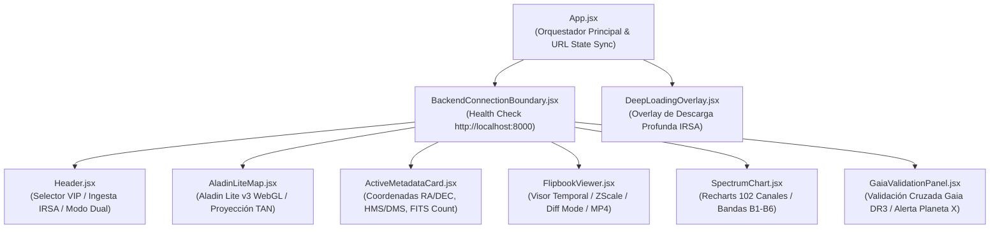

<div align="center">

# 💻 LOOKING FOR STAR — Frontend Architecture & Scientific Visualization
### Visualizador Web de Misión Espacial: React 18, WebGL, Aladin Lite v3 & Recharts

> Interfaz de usuario interactiva y de alto impacto visual para el proyecto **LOOKING FOR STAR (SPHEREx Time-Domain Explorer)**, diseñada para el **NASA International Space Apps Challenge** bajo la especificación **Cosmic Scientific Design System (CSDS Spec v3.0)**.

---

[](https://react.dev/)
[](https://vitejs.dev/)
[](https://tailwindcss.com/)
[](https://aladin.cds.unistra.fr/AladinLite/)
[](https://recharts.org/)
[](https://lucide.dev/)
[](https://eslint.org/)

</div>

---

## 🧭 Navegación entre Módulos

- [⬅️ Volver a la Documentación Principal (`../README.md`)](../README.md)
- [⚙️ Explorar la Documentación del Backend (`../backend/README.md`)](../backend/README.md)

---

## 📑 Tabla de Contenidos

- [Filosofía UX/UI y Sistema de Diseño Cósmico (CSDS)](#-filosofía-uxui-y-sistema-de-diseño-cósmico-csds)
  - [Dualidad de Experiencia: Beginner vs Expert Mode](#dualidad-de-experiencia-beginner-vs-expert-mode)
  - [Tokens Cromáticos y Glassmorphism Espacial](#tokens-cromáticos-y-glassmorphism-espacial)
- [Arquitectura de Componentes Científicos](#-arquitectura-de-componentes-científicos)
  - [1. Sky Survey Navigator (`AladinLiteMap.jsx`)](#1-sky-survey-navigator-aladinlitemapjsx)
  - [2. Time Travel Flipbook & WiseView Controls (`FlipbookViewer.jsx`)](#2-time-travel-flipbook--wiseview-controls-flipbookviewerjsx)
  - [3. Espectrofotómetro Infrarrojo de 102 Canales (`SpectrumChart.jsx`)](#3-espectrofotómetro-infrarrojo-de-102-canales-spectrumchartjsx)
  - [4. Validador Astrométrico ESA Gaia DR3 (`GaiaValidationPanel.jsx`)](#4-validador-astrométrico-esa-gaia-dr3-gaiavalidationpaneljsx)
  - [5. Sincronización Bidireccional de Estado en URL (`App.jsx`)](#5-sincronización-bidireccional-de-estado-en-url-appjsx)
  - [6. Verificación de Integridad de Telemetría (`BackendConnectionBoundary.jsx`)](#6-verificación-de-integridad-de-telemetría-backendconnectionboundaryjsx)
- [Estructura del Directorio `frontend/`](#-estructura-del-directorio-frontend)
- [Consumo de API REST y Contratos de Servicio (`api.js`)](#-consumo-de-api-rest-y-contratos-de-servicio-apijs)
- [Instalación, Ejecución y Scripts de Construcción](#-instalación-ejecución-y-scripts-de-construcción)
- [Créditos de Diseño y Frontend](#-créditos-de-diseño-y-frontend)

---

## 🎨 Filosofía UX/UI y Sistema de Diseño Cósmico (CSDS)

La interfaz de **LOOKING FOR STAR** implementa la especificación formal documentada en [`DESIGN.md`](./DESIGN.md). Su premisa fundacional es erradicar la aridez de las herramientas astronómicas tradicionales sin sacrificar ni un solo ápice de rigor científico:

### Dualidad de Experiencia: Beginner vs Expert Mode
El usuario puede alternar dinámicamente entre dos perfiles de exploración mediante el conmutador superior:

| Característica | 🌟 Beginner Mode (Por Defecto) | 🔬 Expert Mode (Astrofísico / PI) |
|---|---|---|
| **Público Objetivo** | Estudiantes, divulgadores, entusiastas espaciales y jueces. | Astrónomos observacionales, investigadores y desarrolladores. |
| **Complejidad Visual** | Enfoque visual guiado con tarjetas explicativas y contexto histórico. | HUD de telemetría completa con instrumental astrométrico exhaustivo. |
| **Coordenadas Celestes** | Nombres estelares familiares y constelaciones de referencia. | Coordenadas de alta precisión en Decimales ($RA/DEC$) y Sexagesimales ($HMS/DMS$). |
| **Controles de Instrumento** | Animación predeterminada a $5\,\text{fps}$ y visor intuitivo. | Selección manual de épocas ($A$ y $B$), filtros de brillo, contraste e inversión, selector de bandas LVF ($B1-B6$) y umbral $\sigma$ MAD. |
| **Inspección Espectral** | Visualización macro con identificación de agua y metano. | Lectura de flujo fotométrico por píxel específico ($x, y$) con longitud de onda nanométrica. |

### Tokens Cromáticos y Glassmorphism Espacial
La plataforma utiliza un lienzo de espacio profundo con tarjetas de vidrio galáctico flotantes:
- **Deep Space Blue (`#080D1B`):** Fondo abisal con gradientes radiales atmosféricos.
- **Galactic Glass (`bg-[#142B52]/40 backdrop-blur-xl border border-white/10`):** Superficies translúcidas que otorgan jerarquía tridimensional y máxima legibilidad.
- **SPHEREx 6-Band Spectrum:** Cada detector físico cuenta con su propio trazador cromático estandarizado:
  - `B1` ($0.75 - 1.11\,\mu\text{m}$): **Bright Cyan** (`#25D9F2`) — Continuo estelar cercano.
  - `B2` ($1.11 - 1.64\,\mu\text{m}$): **Stellar Blue** (`#3B82F6`) — Fotosferas estelares.
  - `B3` ($1.64 - 2.42\,\mu\text{m}$): **Cosmic Violet** (`#8B5CF6`) — Hielo de agua interestelar ($H_2O$).
  - `B4` ($2.42 - 3.82\,\mu\text{m}$): **Stellar Magenta** (`#E879F9`) — Compuestos orgánicos y metano ($CH_4$).
  - `B5` ($3.82 - 4.42\,\mu\text{m}$): **Carbon Amber** (`#F97316`) — Dióxido de carbono ($CO/CO_2$).
  - `B6` ($4.42 - 5.00\,\mu\text{m}$): **Solar Orange** (`#FFB45E`) — Infrarrojo térmico y enanas ultrafrías.

---

## 🏛️ Arquitectura de Componentes Científicos



### 1. Sky Survey Navigator (`AladinLiteMap.jsx`)
- **Motor WebGL Nativo:** Instancia Aladin Lite v3 configurado estrictamente con proyección Gnomónica `"TAN"` (evitando deformaciones de proyección como `"SIN"` o `"AIT"`).
- **Prospección HiPS:** Alterna entre el sondeo óptico/cercano infrarrojo `CDS/P/2MASS/color` y el sondeo infrarrojo medio `CDS/P/allWISE/color`.
- **Interacción Point & Click Bidireccional:** Escucha eventos de clic en el lienzo WebGL y ejecuta la conversión de coordenadas de pantalla a coordenadas astronómicas $ICRSd$ celestes (`pix2world`).
- **Tiras de Cobertura IRSA Verificada:** Dispone de accesos directos calibrados con cobertura multiepocal confirmada en NASA IRSA:
  - `Ophiuchus Field` ($RA: 269.4850°, DEC: 4.7210°$)
  - `Taurus-Auriga Complex` ($RA: 76.9120°, DEC: 30.4280°$)
  - `Draco NEP Strip` ($RA: 249.1850°, DEC: 66.7820°$)
  - `Hydra IR Sector` ($RA: 133.8210°, DEC: -7.2150°$)

### 2. Time Travel Flipbook & WiseView Controls (`FlipbookViewer.jsx`)
- **Reproducción Multitemporal:** Permite avanzar, retroceder o animar en bucle las exposiciones FITS a $1, 2, 5, 10, 15, 20\,\text{fps}$.
- **Filtros Ópticos en Canvas:** Sliders de brillo, contraste e inversión de polaridad para maximizar la visibilidad de objetos tenues.
- **Sustracción Matricial NumPy en Vivo:** Al activar el modo `diff`, solicita al backend la resta diferencial entre dos épocas arbitrarias (`epochA` y `epochB`), eliminando estrellas de fondo y resaltando asteroides u objetos con movimiento propio extremo.
- **Exportación de Video Científico:** Botón de un solo clic que dispara `GET /export-mp4`, descargando un archivo `.mp4` codificado en H.264 listo para publicaciones o presentaciones.

### 3. Espectrofotómetro Infrarrojo de 102 Canales (`SpectrumChart.jsx`)
- **Renderizado Vectorial Recharts:** Grafica los 102 canales continuos de SPHEREx con un degradado lineal SVG que transiciona suavemente a través de las 6 bandas espectrales ($B1$ a $B6$).
- **Inspección por Píxel:** Si el usuario hace clic sobre un píxel específico en el Flipbook, el gráfico se actualiza en milisegundos mostrando la curva espectral de esa apertura exacta ($3 \times 3$).
- **Líneas de Referencia Moleculares:** Marcadores visuales de absorción clave:
  - Hielo de agua interestelar ($H_2O$ en $2.0\,\mu\text{m}$ y $3.0\,\mu\text{m}$).
  - Hidrocarburos y metano ($CH_4$ en $3.3\,\mu\text{m}$).
  - Hielo de monóxido y dióxido de carbono ($CO/CO_2$ en $4.26\,\mu\text{m}$).

### 4. Validador Astrométrico ESA Gaia DR3 (`GaiaValidationPanel.jsx`)
- **Auditoría en Tiempo Real:** Realiza una consulta asíncrona a `GET /gaia-check` cada vez que cambia el objetivo o las coordenadas.
- **Detección de Anomalías / Planeta X:** Si la fuente emite vigorosamente en el infrarrojo pero no tiene contraparte óptica registrada en Gaia DR3 en un radio de $5''$, el componente muestra una tarjeta de **Alerta de Anomalía Astrométrica**, indicando un fuerte candidato a objeto ultrafrío o cuerpo del sistema solar exterior.

### 5. Sincronización Bidireccional de Estado en URL (`App.jsx`)
Todos los parámetros críticos de la sesión se reflejan en la barra de direcciones mediante `window.history.replaceState` y `URLSearchParams`:
```
http://localhost:5173/?target=barnard&ra=269.4521&dec=4.6933&mode=diff&fps=5&invert=false&epochA=0&epochB=1
```
Esto permite compartir descubrimientos, estados de análisis o vistas específicas de estrellas entre investigadores con solo copiar y pegar el enlace.

### 6. Verificación de Integridad de Telemetría (`BackendConnectionBoundary.jsx`)
Al montar la aplicación, se evalúa `GET http://localhost:8000/health`. Si el backend está apagado o no responde en tiempo y forma, se bloquea la interfaz con un diagnóstico visual claro y un botón de reintento, impidiendo que el usuario opere con datos falseados o simulados.

---

## 📂 Estructura del Directorio `frontend/`

```bash
frontend/
├── index.html                     # Entrada HTML con fuentes Inter y JetBrains Mono
├── package.json                   # Dependencias oficiales (Vite, React, Tailwind, Recharts, Lucide)
├── package-lock.json              # Bloqueo de versiones del árbol npm
├── postcss.config.js              # Pipeline de procesamiento PostCSS
├── tailwind.config.js             # Paleta cromática espacial y tokens CSDS
├── vite.config.js                 # Servidor de desarrollo en puerto 5173
├── DESIGN.md                      # Cosmic Scientific Design System (Especificación CSDS v3.0)
├── README.md                      # Este documento técnico de referencia
├── public/                        # Activos públicos estáticos
│   └── aladin.js                  # Librería Aladin Lite v3 (CDS Strasbourg)
└── src/                           # Código fuente de la aplicación
    ├── App.jsx                    # Orquestador del Dashboard Científico y URL Sync
    ├── index.css                  # Estilos globales, animaciones y scrollbar personalizada
    ├── main.jsx                   # Punto de montaje de React DOM
    ├── components/                # Componentes modulares
    │   ├── ActiveMetadataCard.jsx        # Conversión RA/DEC a HMS/DMS y metadatos FITS
    │   ├── AladinLiteMap.jsx             # Integración Aladin Lite v3 WebGL con Point & Click
    │   ├── BackendConnectionBoundary.jsx # Verificación estricta de salud de FastAPI
    │   ├── CornerReticle.jsx             # Retícula HUD científica con esquinas cósmicas
    │   ├── DeepLoadingOverlay.jsx        # Pantalla de carga para ingestas profundas en IRSA
    │   ├── FlipbookViewer.jsx            # Visor temporal, Modo Diferencia, WiseView y MP4
    │   ├── GaiaValidationPanel.jsx       # Validación astrométrica cruzada con ESA Gaia DR3
    │   ├── Header.jsx                    # Barra superior, selector VIP y conmutador de modo
    │   └── SpectrumChart.jsx             # Espectrofotómetro de 102 canales en Recharts
    └── services/
        └── api.js                 # Capa de consumo HTTP estricta a http://localhost:8000
```

---

## 📡 Consumo de API REST y Contratos de Servicio (`api.js`)

El archivo [`src/services/api.js`](./src/services/api.js) centraliza todas las llamadas HTTP hacia `http://localhost:8000` con manejo riguroso de errores:

```javascript
import {
  checkHealth,           // GET /health
  getTargets,            // GET /api/targets con fallback a /targets
  getFitsManifest,       // GET /fits/{tid}
  getEpochImageUrl,      // GET /fits/{tid}/{index}?format=png
  ingestTarget,          // POST /ingest/{tid}
  getDifference,         // GET /diff/{tid}
  getSpectrum,           // GET /spectrum/{tid}
  exploreSky,            // POST /api/explorar
  checkGaia,             // GET /gaia-check
  exportAndDownloadMp4   // GET /export-mp4
} from './services/api';
```

---

## 🛠️ Instalación, Ejecución y Scripts de Construcción

### Prerrequisitos
- **Node.js**: Versión `18.0.0` o superior instalada (`node -v`).
- **NPM**: Gestor de paquetes de Node (`npm -v`).
- **Backend Activo**: El motor FastAPI debe estar corriendo en `http://localhost:8000`.

### Comandos de Terminal

```bash
# 1. Acceder al directorio del frontend
cd LSAF-NASA/frontend

# 2. Instalar dependencias del proyecto
npm install

# 3. Iniciar el servidor de desarrollo en Vite
npm run dev
```

El panel estará disponible de inmediato en:
👉 **`http://localhost:5173`**

### Scripts Disponibles en `package.json`

| Comando | Acción |
|---|---|
| `npm run dev` | Inicia el servidor de desarrollo local con recarga rápida de módulos (HMR) en el puerto `5173`. |
| `npm run build` | Compila y optimiza la aplicación para producción en la carpeta `dist/`. |
| `npm run preview` | Sirve localmente los archivos compilados de `dist/` para verificar el empaquetado final. |

---

## 👥 Créditos de Diseño y Frontend

- **Isaac Atilano Tobón ([@Yishaq02](https://github.com/Yishaq02))**: Arquitectura Frontend, diseño UI/UX, integración de Aladin Lite v3 y sincronización de estado.
- **Alo**: Co-desarrollo de interfaz, implementación de componentes y refinamiento de la experiencia de usuario.
