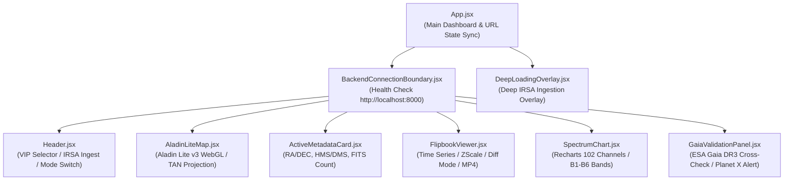

<div align="center">

# 💻 LOOKING FOR STAR — Frontend Architecture & Scientific Visualization
### Space Mission Web Dashboard: React 18, WebGL, Aladin Lite v3 & Recharts

> High-fidelity astronomical user interface for the **LOOKING FOR STAR (SPHEREx Time-Domain Explorer)** project, engineered for the **NASA International Space Apps Challenge** under the **Cosmic Scientific Design System (CSDS Spec v3.0)**.

---

[](https://react.dev/)
[](https://vitejs.dev/)
[](https://tailwindcss.com/)
[](https://aladin.cds.unistra.fr/AladinLite/)
[](https://recharts.org/)
[](https://lucide.dev/)
[](https://eslint.org/)

</div>

---

## 🧭 Navigation

- [⬅️ Back to Monorepo Root (`../README.md`)](../README.md)
- [⚙️ Explore Backend Documentation (`../backend/README.md`)](../backend/README.md)

---

## 📑 Table of Contents

- [UI/UX Philosophy & Cosmic Scientific Design System (CSDS)](#-uiux-philosophy--cosmic-scientific-design-system-csds)
  - [Dual Experience Paradigm: Beginner vs Expert Mode](#dual-experience-paradigm-beginner-vs-expert-mode)
  - [Chromatic Tokens & Deep Space Glassmorphism](#chromatic-tokens--deep-space-glassmorphism)
  - [SPHEREx 6-Band LVF Spectral Mapping](#spherex-6-band-lvf-spectral-mapping)
- [Scientific Component Architecture & Visual Modules](#-scientific-component-architecture--visual-modules)
  - [1. Sky Survey Navigator (`AladinLiteMap.jsx`)](#1-sky-survey-navigator-aladinlitemapjsx)
  - [2. Time Travel Flipbook & WiseView Controls (`FlipbookViewer.jsx`)](#2-time-travel-flipbook--wiseview-controls-flipbookviewerjsx)
  - [3. 102-Channel Infrared Spectrophotometer (`SpectrumChart.jsx`)](#3-102-channel-infrared-spectrophotometer-spectrumchartjsx)
  - [4. ESA Gaia DR3 Astrometric Validator (`GaiaValidationPanel.jsx`)](#4-esa-gaia-dr3-astrometric-validator-gaiavalidationpaneljsx)
  - [5. Bidirectional URL State Synchronization (`App.jsx`)](#5-bidirectional-url-state-synchronization-appjsx)
  - [6. Telemetry Health Boundary (`BackendConnectionBoundary.jsx`)](#6-telemetry-health-boundary-backendconnectionboundaryjsx)
- [Directory Hierarchy (`frontend/`)](#-directory-hierarchy-frontend)
- [REST API Client & Service Contracts (`api.js`)](#-rest-api-client--service-contracts-apijs)
- [Installation, Development & Build Scripts](#-installation-development--build-scripts)
- [UI/UX & Frontend Engineering Credits](#-uiux--frontend-engineering-credits)

---

## 🎨 UI/UX Philosophy & Cosmic Scientific Design System (CSDS)

The interface of **LOOKING FOR STAR** translates the formal design specification established in [`DESIGN.md`](./DESIGN.md) into code. It reconciles professional astrophysics data visualization with accessible, publication-grade aesthetics:

### Dual Experience Paradigm: Beginner vs Expert Mode
Users can dynamically switch between two exploration interfaces using the top header toggle:

| Dimension | 🌟 Beginner Mode (Default) | 🔬 Expert Mode (Astronomer / PI) |
|---|---|---|
| **Target Audience** | Students, educators, science communicators, and judges. | Observational astronomers, astrophysics researchers, and engineers. |
| **Interface Complexity** | Guided visual exploration with narrative stellar profiles. | Full astrophysical instrumentation HUD and telemetry readouts. |
| **Coordinate System** | Familiar star names and benchmark constellation contexts. | Decimal ($RA/DEC$) and sexagesimal ($HMS/DMS$) coordinates with copy actions. |
| **Instrument Controls** | Clean $5\,\text{fps}$ loop playback and intuitive flipbook controls. | Manual epoch pairing ($A$ and $B$), brightness/contrast/invert sliders, LVF detector selectors ($B1-B6$), and MAD $\sigma$ sensitivity tuning. |
| **Spectral Inspection** | Integrated curve with key water and methane tags. | Single-pixel aperture inspection ($3 \times 3$) with nanometer-precise flux data. |

### Chromatic Tokens & Deep Space Glassmorphism
The user experience is anchored on a deep cosmic palette:
- **Deep Space Blue (`#080D1B`):** Canvas background illuminated by atmospheric volumetric radial glows.
- **Galactic Glass (`bg-[#142B52]/40 backdrop-blur-xl border border-white/10`):** Translucent cards that maximize contrast for infrared imagery and spectral graphs.
- **Subtle Surface Definition (`rgba(255,255,255,0.1)`):** Ultra-crisp vector boundaries eliminating visual clutter.

### SPHEREx 6-Band LVF Spectral Mapping
Each Linear Variable Filter (LVF) detector array is assigned a dedicated astrophysical color token:
- `B1` ($0.75 - 1.11\,\mu\text{m}$): **Bright Cyan** (`#25D9F2`) — Near-IR stellar continuum.
- `B2` ($1.11 - 1.64\,\mu\text{m}$): **Stellar Blue** (`#3B82F6`) — Stellar photospheres.
- `B3` ($1.64 - 2.42\,\mu\text{m}$): **Cosmic Violet** (`#8B5CF6`) — Interstellar water ice ($H_2O$).
- `B4` ($2.42 - 3.82\,\mu\text{m}$): **Stellar Magenta** (`#E879F9`) — Organics, hydrocarbons, and methane ($CH_4$).
- `B5` ($3.82 - 4.42\,\mu\text{m}$): **Carbon Amber** (`#F97316`) — Solid carbon monoxide and dioxide ($CO/CO_2$).
- `B6` ($4.42 - 5.00\,\mu\text{m}$): **Solar Orange** (`#FFB45E`) — Thermal infrared and sub-stellar brown dwarfs.

---

## 🏛️ Scientific Component Architecture & Visual Modules



### 1. Sky Survey Navigator (`AladinLiteMap.jsx`)
- **WebGL Engine:** Embeds Aladin Lite v3 configured strictly with a Gnomonic Tangential projection (`"TAN"`), preventing distortion artifacts associated with sinusoidal or Aitoff mappings.
- **Survey Switching:** Toggles seamlessly between `CDS/P/2MASS/color` (optical/near-IR) and `CDS/P/allWISE/color` (mid-IR).
- **Interactive Point & Click:** Captures canvas pointer events and executes high-precision screen-to-celestial coordinate transformation (`pix2world` in $ICRSd$).
- **Verified IRSA Observational Strips:** Provides direct camera positioning for sectors with verified multi-epoch coverage in NASA IRSA:
  - `Ophiuchus Field` ($RA: 269.4850°, DEC: 4.7210°$)
  - `Taurus-Auriga Complex` ($RA: 76.9120°, DEC: 30.4280°$)
  - `Draco NEP Strip` ($RA: 249.1850°, DEC: 66.7820°$)
  - `Hydra IR Sector` ($RA: 133.8210°, DEC: -7.2150°$)

### 2. Time Travel Flipbook & WiseView Controls (`FlipbookViewer.jsx`)
- **Multi-Epoch Motion Engine:** Loops, steps, and animates calibrated FITS frames at $1, 2, 5, 10, 15, 20\,\text{fps}$.
- **Real-Time Optical Filters:** Hardware-accelerated canvas controls for brightness, contrast, and polarity inversion.
- **On-the-Fly NumPy Difference:** Triggers backend matrix subtraction ($\text{Epoch } A - \text{Epoch } B$) with MAD sigma-clipping, exposing motion dipoles while nulling static background stars.
- **Scientific MP4 Export:** Triggers `GET /export-mp4` and initiates automated browser download of an H.264 animation.

### 3. 102-Channel Infrared Spectrophotometer (`SpectrumChart.jsx`)
- **Vector Recharts Rendering:** Renders all 102 SPHEREx channels with a multi-stop SVG linear gradient traversing bands $B1$ through $B6$.
- **Pixel-Level Inspection:** Clicking any pixel on the Flipbook viewer requests a targeted $3 \times 3$ aperture integration at that coordinate, updating the plot in milliseconds.
- **Diagnostic Molecular Absorption Flags:** Visual reference lines marking signature transitions:
  - Interstellar water ice ($H_2O$ at $2.0\,\mu\text{m}$ and $3.0\,\mu\text{m}$).
  - Gaseous methane and hydrocarbons ($CH_4$ at $3.3\,\mu\text{m}$).
  - Solid carbon monoxide and dioxide ($CO/CO_2$ at $4.26\,\mu\text{m}$).

### 4. ESA Gaia DR3 Astrometric Validator (`GaiaValidationPanel.jsx`)
- **Automated Catalog Cross-Check:** Dispatches asynchronous queries to `GET /gaia-check` on target or coordinate changes.
- **Planet X / Anomaly Notification:** When infrared flux is confirmed but no optical catalog match exists within $5''$, an **Astrometric Anomaly Banner** is raised, flagging the source as a candidate ultra-cool brown dwarf or outer Solar System transiting body.

### 5. Bidirectional URL State Synchronization (`App.jsx`)
Session parameters are continually synchronized with the browser address bar via `window.history.replaceState` and `URLSearchParams`:
```
http://localhost:5173/?target=barnard&ra=269.4521&dec=4.6933&mode=diff&fps=5&invert=false&epochA=0&epochB=1
```
This enables sharing exact celestial coordinates, display parameters, and analysis states via simple URL links.

### 6. Telemetry Health Boundary (`BackendConnectionBoundary.jsx`)
On initial mount, the boundary checks `GET http://localhost:8000/health`. If the backend is unreachable, the dashboard displays a diagnostic modal with automated retry capability, enforcing the **Zero-Simulation Policy**.

---

## 📂 Directory Hierarchy (`frontend/`)

```bash
frontend/
├── index.html                     # HTML root with Inter & JetBrains Mono fonts
├── package.json                   # NPM manifest (Vite, React, Tailwind, Recharts, Lucide)
├── package-lock.json              # Frozen dependency tree lock
├── postcss.config.js              # PostCSS build pipeline
├── tailwind.config.js             # CSDS theme colors and cosmic tokens
├── vite.config.js                 # Vite bundler configuration (Port 5173)
├── DESIGN.md                      # Cosmic Scientific Design System specification (CSDS v3.0)
├── README.md                      # This technical reference manual
├── public/                        # Public static web assets
│   └── aladin.js                  # Aladin Lite v3 WebGL client
└── src/                           # Application source code
    ├── App.jsx                    # Scientific dashboard orchestrator & URL state manager
    ├── index.css                  # Global CSS rules, animations, and custom scrollbar
    ├── main.jsx                   # React DOM root entry point
    ├── components/                # Modular UI components
    │   ├── ActiveMetadataCard.jsx        # RA/DEC coordinate displays & HMS/DMS formatters
    │   ├── AladinLiteMap.jsx             # Aladin Lite v3 WebGL interactive sky map
    │   ├── BackendConnectionBoundary.jsx # Strict FastAPI health & connection guard
    │   ├── CornerReticle.jsx             # Sci-Fi HUD reticle frame
    │   ├── DeepLoadingOverlay.jsx        # Ingestion loading overlay for deep IRSA queries
    │   ├── FlipbookViewer.jsx            # Multi-epoch WiseView, Diff mode, and MP4 export
    │   ├── GaiaValidationPanel.jsx       # ESA Gaia DR3 astrometric cross-checker
    │   ├── Header.jsx                    # Header bar, target selector, and mode switch
    │   └── SpectrumChart.jsx             # 102-channel spectrophotometer (Recharts)
    └── services/
        └── api.js                 # Strict HTTP client connected to http://localhost:8000
```

---

## 📡 REST API Client & Service Contracts (`api.js`)

The [`src/services/api.js`](./src/services/api.js) module encapsulates all HTTP communication with the backend service running at `http://localhost:8000`:

```javascript
import {
  checkHealth,           // GET /health
  getTargets,            // GET /api/targets (fallback to /targets)
  getFitsManifest,       // GET /fits/{tid}
  getEpochImageUrl,      // GET /fits/{tid}/{index}?format=png
  ingestTarget,          // POST /ingest/{tid}
  getDifference,         // GET /diff/{tid}
  getSpectrum,           // GET /spectrum/{tid}
  exploreSky,            // POST /api/explorar
  checkGaia,             // GET /gaia-check
  exportAndDownloadMp4   // GET /export-mp4
} from './services/api';
```

---

## 🛠️ Installation, Development & Build Scripts

### Prerequisites
- **Node.js**: Version `18.0.0` or higher (`node -v`).
- **NPM**: Node package manager (`npm -v`).
- **Active Backend**: The FastAPI backend must be running at `http://localhost:8000`.

### Terminal Commands

```bash
# 1. Navigate to the frontend directory
cd LSAF-NASA/frontend

# 2. Install application dependencies
npm install

# 3. Start the Vite development server
npm run dev
```

Access the application in your browser:
👉 **`http://localhost:5173`**

### Available NPM Scripts

| Script Command | Action |
|---|---|
| `npm run dev` | Launches the local development server with Hot Module Replacement (HMR) on port `5173`. |
| `npm run build` | Compiles and tree-shakes the application into production-optimized bundles in `dist/`. |
| `npm run preview` | Spins up a local web server to preview the production build from `dist/`. |

---

## 👥 UI/UX & Frontend Engineering Credits

- **Isaac Atilano Tobón ([@Yishaq02](https://github.com/Yishaq02))**: Frontend architecture, UI/UX design, Aladin Lite v3 WebGL integration, and state synchronization.
- **Alo**: Frontend co-development, component layout implementation, and interface styling.
